# <p align="center">Varr-Bot</p>

Bot WhatsApp modular berbasis [Baileys](https://github.com/WhiskeySockets/Baileys) untuk kebutuhan grup, produktivitas, media, AI, dan otomasi. Varr-Bot dirancang agar mudah dirawat, aman dipakai, dan gampang ditambah fitur baru lewat sistem plugin.

> **Status:** Fondasi Phase 1–2 selesai. Source saat ini juga sudah memuat AI multi-provider, media suite, downloader multi-platform, dan economy (55 command).

## Kenapa Varr-Bot?

Banyak bot WhatsApp open source punya ratusan command, tapi sering terkendala oleh:

- kode monolitik dan sulit dirawat;
- command berbahaya tanpa kontrol permission;
- tidak ada cooldown, rate limit, atau audit log;
- data pengguna disimpan tanpa batas;
- API key ditulis langsung di source code;
- fitur banyak tetapi saling bertabrakan.

Varr-Bot mengambil **ide dan pola terbaik** dari bot-bot populer, lalu dibangun ulang dengan fokus pada:

- **Modular** — setiap fitur adalah plugin dengan manifest yang jelas.
- **Aman** — permission berlapis, validasi input, tanpa `eval`, dan rahasia tidak pernah di-log.
- **Privasi** — retensi data dibatasi dan bisa dikonfigurasi.
- **Observable** — log terstruktur, statistik command, dan health check.
- **Portable** — jalan di Windows, Linux, VPS, Docker, PM2, dan Termux.

## Fitur

Ringkasan kategori (detail lengkap ada di [docs/FEATURES.md](docs/FEATURES.md)). ✅ = sudah ada di source saat ini, ⏳ = fase berikutnya.

| Kategori | Contoh fitur | Status |
|---|---|---|
| Core & UX | Menu per kategori, help, ping, multi-bahasa, prefix fleksibel | ✅ |
| Manajemen grup | Welcome/goodbye, promote/demote, kick, mute, tagall, hidetag, group info, warning | ✅ |
| Varr Guard | Anti-link, anti-spam, batas warning, eskalasi warning → kick, guard status | ✅ |
| Sticker & media | Sticker maker, sticker → gambar, MP3, PDF, QR, baca QR | ✅ |
| Downloader | YouTube MP3/MP4, TikTok, Instagram, Facebook, X, Threads, Pinterest, Spotify, SoundCloud | ✅ |
| Owner & system | Ban/unban, mode, maintenance, stats, backup & restore, Varr Doctor | ✅ |
| AI | Multi-provider free-first (Gemini, Groq, OpenRouter), chatbot, ringkasan, translate | ✅ |
| Economy | Daily reward, balance, level, leaderboard | ✅ |
| AI vision & games | Vision, RPG, mini games | ⏳ Phase 4 |
| Utility lain | Cuaca, berita, Wikipedia, lyrics, kalkulator | ⏳ Phase 4 |
| Automation | Reminder, scheduler, broadcast, auto-reply | ⏳ Phase 4 |
| Scale (lanjutan) | Jadibot multi-session, REST API, web dashboard | ⏳ Phase 5 |

Beberapa fitur pembeda yang sudah ada atau akan ditambahkan:

- **Varr Doctor** ✅ — diagnosa kesehatan bot, session, database, disk, FFmpeg, sharp, yt-dlp.
- **Varr Guard** ✅ — moderasi berbasis severity (delete → warn → kick), bukan sekadar on/off.
- **Plugin manifest** ✅ — permission, cooldown, alias, scope, dan file bantuan `_*.js`.
- **Backup terverifikasi** ✅ — backup SQLite dicek integritasnya dan bisa dipulihkan tanpa restart.
- **Varr Memory**, **Varr Insights**, **Varr SafeMode**, **AI budget guard** — direncanakan di fase berikutnya.


## Command

### Umum & owner

| Command | Akses | Fungsi |
|---|---|---|
| `.menu` | semua | Daftar command sesuai role |
| `.help <command>` | semua | Detail penggunaan, alias, cooldown |
| `.ping` | semua | Latensi, uptime, memori, status database |
| `.alive` | semua | Status singkat bot |
| `.owner` | semua | Kontak owner |
| `.mode [public\|private\|self]` | owner | Ubah mode bot tanpa restart |
| `.maintenance [on\|off]` | owner | Blokir command non-darurat saat maintenance |
| `.ban <@user\|reply\|nomor\|group> [alasan]` | owner | Blokir pengguna/grup dari bot |
| `.unban <@user\|reply\|nomor\|group>` | owner | Buka kembali blokir |
| `.stats` | owner | Statistik command, pengguna, grup, warning, DB |
| `.backup [list\|verify <nama>]` | owner | Buat/daftar/verifikasi backup terverifikasi |
| `.restore <nama\|latest> confirm` | owner | Pulihkan database dari backup |
| `.doctor` | owner | Cek session, database, disk, FFmpeg, sharp, yt-dlp |

### Grup (admin grup atau owner)

| Command | Fungsi |
|---|---|
| `.welcome [on\|off\|set <teks>\|reset]` | Sambutan anggota baru; placeholder `{name}`, `{mention}`, `{group}`, `{desc}`, `{count}` |
| `.goodbye [on\|off\|set <teks>\|reset]` | Pesan perpisahan anggota keluar |
| `.promote` / `.demote` | Jadikan / cabut admin |
| `.kick` | Keluarkan anggota (bot harus admin) |
| `.mute` / `.unmute` | Tutup / buka grup |
| `.tagall` / `.hidetag` | Mention semua anggota / mention tersembunyi |
| `.groupinfo` | Info grup, admin, mode pesan |
| `.warn` / `.warnings` / `.unwarn` | Kelola warning dan lihat riwayatnya |

### Varr Guard (admin grup atau owner)

| Command | Fungsi |
|---|---|
| `.antilink [on\|off\|delete\|warn\|kick]` | Guard tautan |
| `.antispam [on\|off\|delete\|warn\|kick]` | Guard flood & pesan berulang |
| `.setwarnlimit <1-10>` | Batas warning sebelum anggota dikeluarkan |
| `.guardstatus` | Ringkasan aturan guard aktif |

Admin grup dan owner selalu dikecualikan dari guard. Eskalasi: warning → keluarkan saat batas tercapai (WhatsApp tidak punya mute per anggota; lihat ADR-009).

### Media & downloader

| Command | Fungsi |
|---|---|
| `.sticker` | Gambar/GIF → sticker WebP |
| `.toimg` | Sticker → gambar PNG |
| `.ytmp3 <url>` | Audio YouTube → MP3 |
| `.ytmp4 <url> [resolusi]` | Video YouTube → MP4 (144p–1080p, default 720p) |
| `.tiktok <url>` | Video TikTok tanpa watermark |

Downloader memakai **yt-dlp** + **FFmpeg**. Metadata dan media diambil dalam **satu** proses yt-dlp (`--print before_dl:`), jadi tidak ada panggilan probe terpisah — unduhan lebih cepat. Batas ukuran, durasi, timeout, jumlah unduhan paralel, dan antrean bisa diatur lewat `.env`. Command downloader punya timeout internal sendiri, jadi tidak terpotong `COMMAND_TIMEOUT_MS` yang lebih pendek. `.ytmp4` menerima resolusi (`144p`–`1080p`, default `720p`); di atas 720p yt-dlp menggabungkan video+audio karena YouTube tidak menyediakan MP4 progresif. Ukuran hasil tetap dibatasi `DOWNLOAD_MAX_MB`, jadi 1080p biasanya butuh nilai lebih tinggi (mis. 64). Hasilnya diverifikasi dengan ffprobe (durasi harus sesuai sumber dan audio tidak boleh hilang) lalu dinormalisasi ke **H.264 + AAC** dengan `faststart` supaya bisa diputar di WhatsApp; AV1/VP9/HEVC otomatis ditranscode bila perlu.

Urutan pencarian binary: `BIN_DIR` → `PATH` (atau path absolut di `YTDLP_PATH`). Jika `YTDLP_AUTO_INSTALL=true` dan yt-dlp belum ada, bot memasangnya sekali dari rilis resmi GitHub dengan verifikasi checksum SHA-256; fitur ini nonaktif secara default. `FFMPEG_PATH` bisa diisi path absolut bila FFmpeg tidak ada di `PATH`. Untuk video yang butuh login/usia, isi `YTDLP_COOKIES_FILE` dengan file cookies format Netscape. Jika dependensi tidak siap, command memberi tahu dan `.doctor` melaporkannya.

Mode: **public** = semua orang, **private** = owner + admin grup, **self** = owner saja.

## Menjalankan

Prasyarat:

- **Node.js 20+** (Docker memakai Node.js 22 LTS).
- **yt-dlp** di `PATH`, di `BIN_DIR`, atau lewat `YTDLP_PATH` untuk command downloader.
- **FFmpeg** untuk konversi audio/video (`ytmp3` butuh ini); bisa lewat `FFMPEG_PATH`.
- **sharp** terpasang otomatis lewat `npm install` (dipakai sticker/toimg).

> Di Windows, tutup dan buka ulang terminal setelah memasang yt-dlp/FFmpeg agar perubahan `PATH` terpakai. Alternatifnya isi `YTDLP_PATH`/`FFMPEG_PATH` dengan path absolut atau taruh binary di `BIN_DIR`.

```bash
npm install
copy .env.example .env     # Windows
# cp .env.example .env     # Linux/macOS
npm start
```

Isi minimal `OWNER_NUMBERS` di `.env`. Untuk login:

- **QR Code** — biarkan `LOGIN_METHOD` kosong dan `PAIRING_NUMBER` kosong, lalu scan QR di terminal.
- **Pairing Code** — isi `PAIRING_NUMBER=628xxxxxxxxxx` (dengan kode negara), jalankan bot, lalu masukkan kode 8 digit di WhatsApp → Perangkat tertaut.

Session disimpan di `auth_info_baileys/`, database di `data/varr.db`, backup di `data/backups/`, file sementara downloader di `data/tmp/`. Jangan commit semuanya.

```bash
npm test
```

### Backup & restore

Backup otomatis berjalan setiap 24 jam dan saat shutdown, dengan retensi `BACKUP_KEEP` (default 14).

```text
.backup                          # buat backup + verifikasi integritas
.backup list                     # daftar backup
.backup verify latest            # cek integritas + skema + jumlah baris
.restore latest confirm          # pulihkan (backup pengaman dibuat dulu)
```

Restore dilakukan **in-place** (tanpa restart) lewat `ATTACH DATABASE` di dalam satu transaksi, dan hanya menerima backup dengan versi skema yang sama.

### Docker

```bash
copy .env.example .env   # isi OWNER_NUMBERS dulu
docker compose up -d --build
docker logs -f varr-bot
```

Catatan:

- Container membaca config dari `.env` lewat `env_file`. Tanpa `.env`, bot tetap jalan tetapi tanpa owner.
- Image sudah berisi FFmpeg dan yt-dlp. Jika downloader tiba-tiba gagal setelah situs sumber berubah, perbarui yt-dlp di image lalu bangun ulang.
- `auth_info_baileys/` dan `data/` di-mount sebagai volume. Di Linux, pastikan folder host bisa ditulis user container (UID 1000): `sudo chown -R 1000:1000 auth_info_baileys data`.
- `restart: on-failure:5` mencegah crash-loop tanpa henti saat sesi logout. Jika session mati, hapus `auth_info_baileys/` lalu pairing ulang.
- `docker compose down` mengirim `SIGTERM`; bot menutup socket dan membuat backup sebelum keluar (`stop_grace_period: 30s`).

Untuk Pterodactyl, baca [docs/DECISIONS.md](docs/DECISIONS.md).

## Struktur Repo

```text
.
├── src/
│   ├── index.js              # bootstrap: config, DB, registry, connection, shutdown
│   ├── config/index.js       # loader & validasi environment
│   ├── core/
│   │   ├── connection.js     # Baileys: QR/pairing, reconnect, graceful shutdown
│   │   ├── handler.js        # messages.upsert → guard → pipeline command
│   │   ├── queue.js          # queue eksekusi per chat
│   │   ├── messageCache.js   # cache pesan untuk getMessage (retry)
│   │   ├── registry.js       # manifest command + auto-load src/commands
│   │   ├── middleware/       # normalize, banned, maintenance, mode, permission, scope, cooldown, rate limit
│   │   ├── database/         # interface + driver SQLite (skema v2, backup, restore)
│   │   ├── state.js          # mode & maintenance runtime
│   │   ├── health.js         # laporan kesehatan
│   │   ├── i18n.js           # translator id/en
│   │   ├── logger.js         # pino + redaksi rahasia
│   │   └── errors.js         # AppError, timeout
│   ├── commands/
│   │   ├── general/          # menu, help, ping, alive, owner
│   │   ├── group/            # welcome, goodbye, promote, demote, kick, mute, tagall, warn, ...
│   │   ├── guard/            # antilink, antispam, setwarnlimit, guardstatus
│   │   ├── media/            # sticker, toimg, tomp3, topdf, qr, readqr
│   │   ├── downloader/       # ytmp3, ytmp4, tiktok, ig, fb, x, threads, pinterest, spotify, soundcloud (+ _shared.js)
│   │   ├── ai/               # ai, chatbot, resetai, summary, translate (+ _shared.js)
│   │   ├── economy/          # balance, daily, level, leaderboard (+ _shared.js)
│   │   ├── owner/            # mode, maintenance, ban, unban, stats, backup, restore
│   │   └── tools/            # doctor
│   ├── services/             # guard, groupEvents, media, downloader, warnings, ai, aiMemory
│   ├── locales/              # id.json, en.json
│   └── utils/                # text, jid, group, groupTarget, groupModeration, economy, chatbot, backups, ...
├── tests/                    # node:test
├── docs/
├── data/                     # runtime DB, backup, tmp (tidak di-commit)
├── auth_info_baileys/        # session WhatsApp (tidak di-commit)
├── Dockerfile
├── docker-compose.yml
└── package.json
```


## Arsitektur & Alur

Bagian ini adalah peta cara kerja Varr-Bot dari proses start sampai pesan dibalas. Diagram mengikuti kode di `src/`; registry saat ini memuat 55 command.

Urutan baca yang disarankan: **siklus hidup (2) → pesan masuk (3) → pipeline middleware (4)**, lalu guard/event grup (5), alur layanan (6), dan data (7).

### 1. Peta komponen

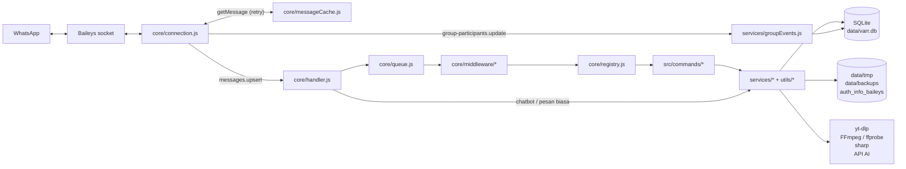

| Lapisan | Modul | Tanggung jawab |
|---|---|---|
| Bootstrap | `index.js`, `src/index.js` | Merakit dependency, menjalankan koneksi, shutdown. |
| Konfigurasi | `src/config/index.js` | Membaca `.env`, validasi nilai, mengubah path relatif menjadi absolut. |
| Koneksi | `core/connection.js`, `core/messageCache.js` | Baileys, QR/pairing, reconnect, cache pesan untuk retry. |
| Masuk | `core/handler.js` | Filter pesan, deduplikasi, guard, parsing, queue, chatbot. |
| Eksekusi | `core/queue.js`, `core/middleware/*`, `core/registry.js` | Serialisasi per chat, pipeline izin, manifest command. |
| Fitur | `src/commands/*` | Command tipis: validasi argumen, panggil service, balas. |
| Domain | `src/services/*`, `src/utils/*` | Guard, warning, media, downloader, AI, ekonomi, format. |
| Data | `core/database/*` | SQLite, migrasi, setting, statistik, audit, backup/restore. |
| Observability | `core/logger.js`, `core/health.js`, `.doctor` | Log terstruktur, health report, diagnosa dependency. |

### 2. Siklus hidup proses

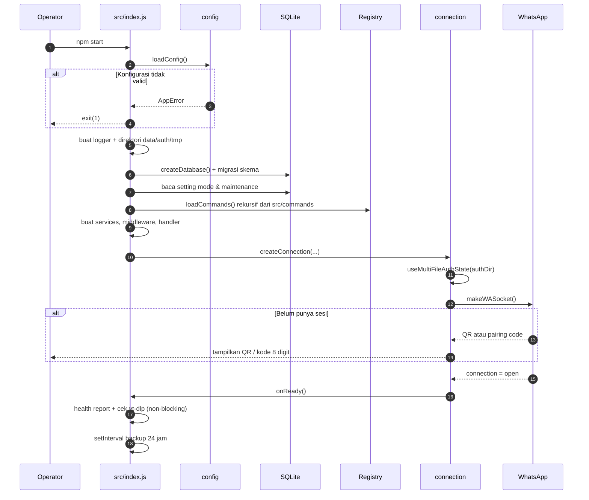

Saat koneksi putus, `connection.js` membedakan gangguan sementara dan sesi permanen:

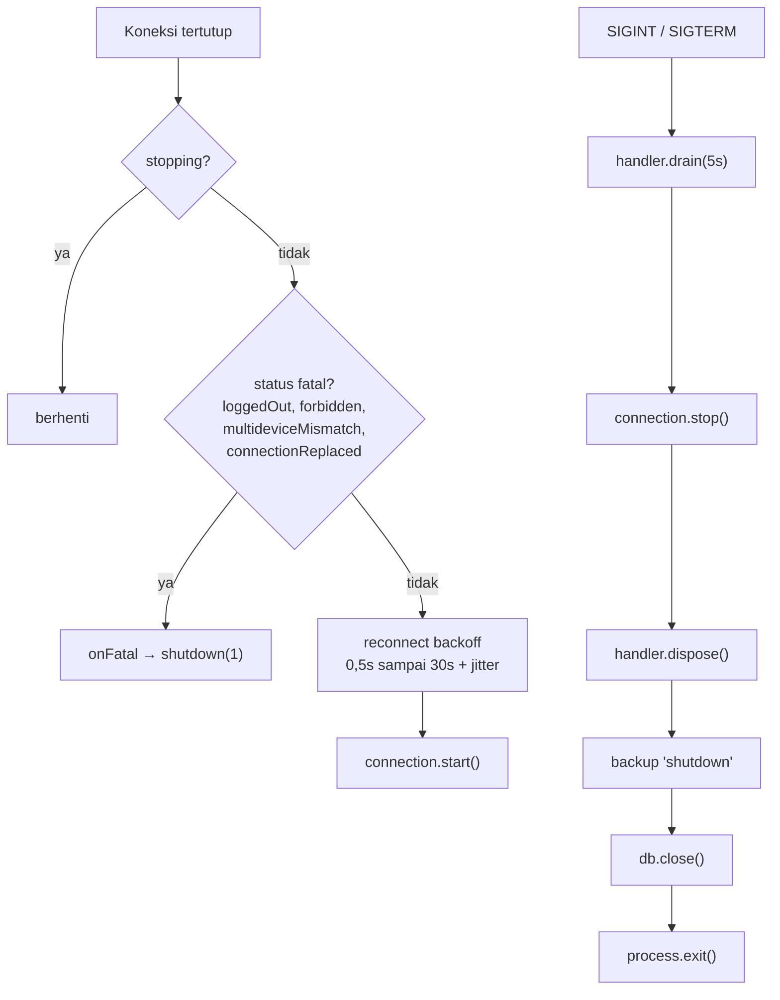

`shutdown()` idempotent: pemanggilan berikutnya memakai promise yang sama. Backup terjadwal berjalan tiap 24 jam dan saat shutdown, dengan retensi `BACKUP_KEEP` (default 14).

### 3. Alur pesan masuk

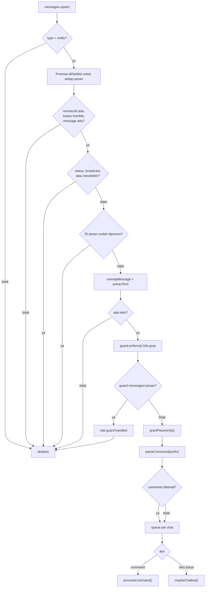

Semua pesan yang lolos filter masuk ke queue yang sama. Queue bersifat **per chat**: pesan dari chat yang sama diproses berurutan, sedangkan chat berbeda berjalan paralel. Batas default 50 pesan menunggu per chat dan 500 chat aktif; bila penuh, pesan dilewati dan dicatat di log.

**Cabang command:**

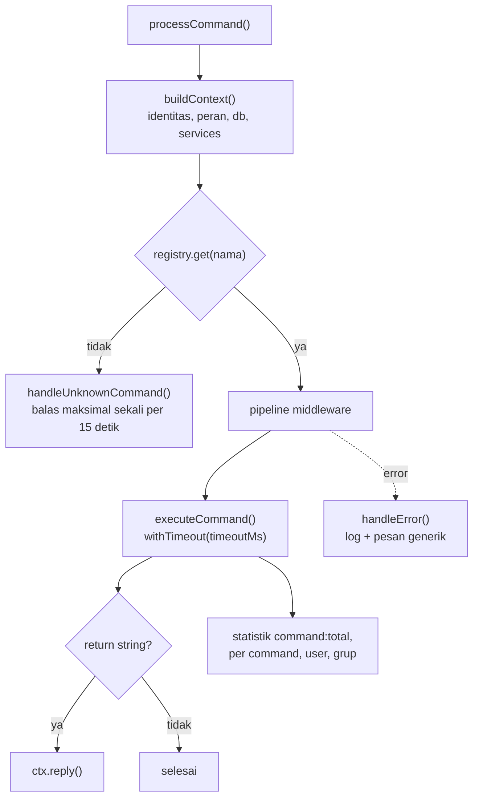

Command tidak dikenal tidak dibalas di mode `private`/`self` bila pengirim bukan owner, supaya keberadaan bot tidak bocor. Command yang mengembalikan string otomatis dikirim sebagai balasan; command yang mengirim media mengembalikan `null`.

**Cabang chatbot:**

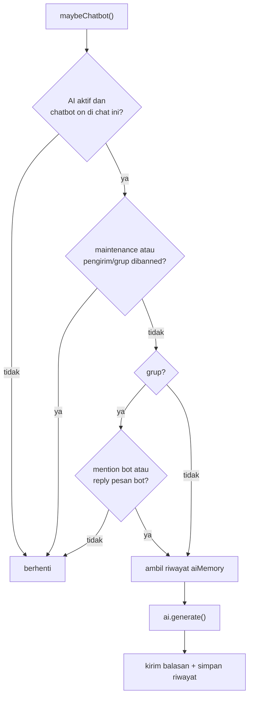

Status chatbot disimpan di database: `group_settings.chatbot` untuk grup dan `settings.chatbot:<jid>` untuk chat pribadi. Riwayat AI hanya di memori (30 menit, maksimal 20 pesan per scope) dan di-reset lewat `.resetai`.

### 4. Pipeline middleware

Urutan ini hanya berjalan untuk command, bukan chatbot:

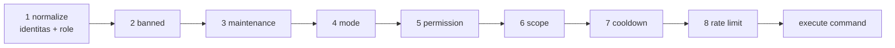

| Middleware | Yang dicek | Pengecualian |
|---|---|---|
| `normalize` | Identitas pengirim, metadata grup, role, daftar user/grup di DB. | — |
| `banned` | User/grup yang diblokir owner. | Owner selalu lolos. Grup diblokir diabaikan tanpa balasan; user diblokir diberi tahu sekali per 10 menit. |
| `maintenance` | Status maintenance runtime. | Owner dan command `maintenanceSafe`. |
| `mode` | `public`, `private`, atau `self`. | Owner selalu lolos. `private` mengizinkan admin grup; `self` hanya owner. |
| `permission` | Hierarki `user < premium < admin < owner`. | — |
| `scope` | `all`, `group`, atau `private`. | — |
| `cooldown` | Cooldown per pengirim + command. | Owner. Default 3 detik bila manifest tidak mengisi. |
| `rate limit` | Sliding window per pengirim. | Owner. Default 20 command per 60 detik. |

Middleware yang tidak memanggil `next()` menghentikan pipeline. Error di command ditangkap `handleError`, dicatat, dan pengguna menerima pesan yang aman (detail internal tidak dikirim).

### 5. Guard dan event grup

**Guard** berjalan untuk seluruh pesan teks grup, termasuk pesan yang berisi command:

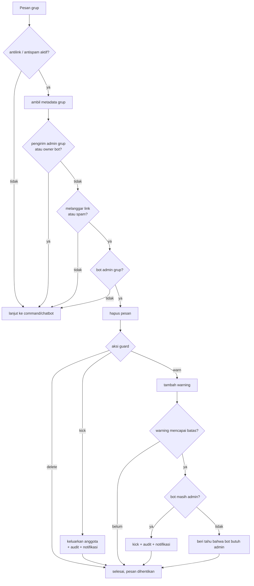

Deteksi spam memakai 6 pesan dalam 5 detik atau 3 pesan teks identik dalam 10 detik. Batas warning default 3 dan bisa diubah `.setwarnlimit` (1–10). Bila guard sudah menangani pesan, command di pesan tersebut tidak dieksekusi.

**Event grup** (welcome/goodbye) tidak lewat handler pesan:

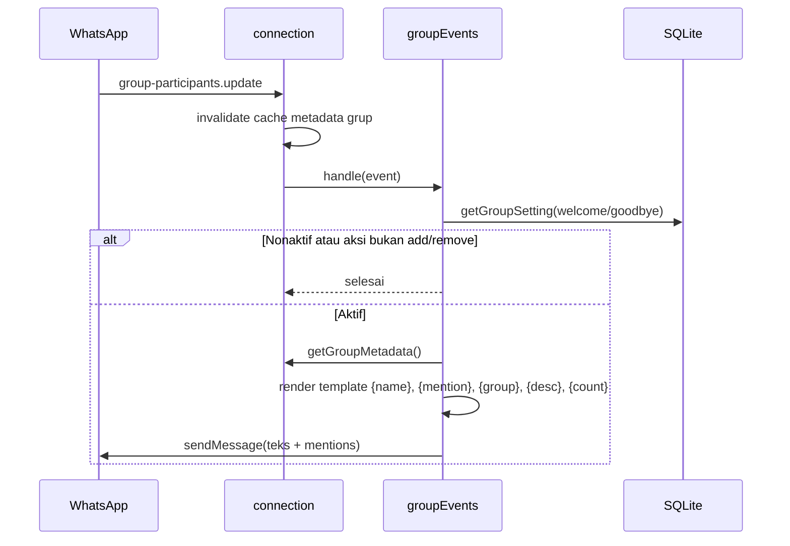

Promote/demote sengaja tidak mengirim pesan. Maksimal 10 peserta diproses per event dan template dibatasi 1.000 karakter.

### 6. Alur layanan domain

**Media dasar** (`.sticker`, `.toimg`, `.tomp3`, `.topdf`, `.qr`, `.readqr`):

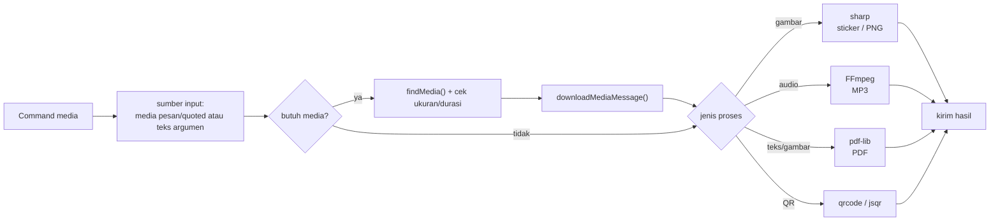

Dependency opsional (`sharp`, `pdf-lib`, `qrcode`, `jsqr`) dimuat dengan aman; bila salah satu tidak ada, hanya fitur terkait yang dinonaktifkan dan command memberi tahu pengguna.

**Downloader** (`.ytmp3`, `.ytmp4`, `.tiktok`, `.ig`, `.fb`, `.x`, `.threads`, `.pinterest`, `.spotify`, `.soundcloud`):

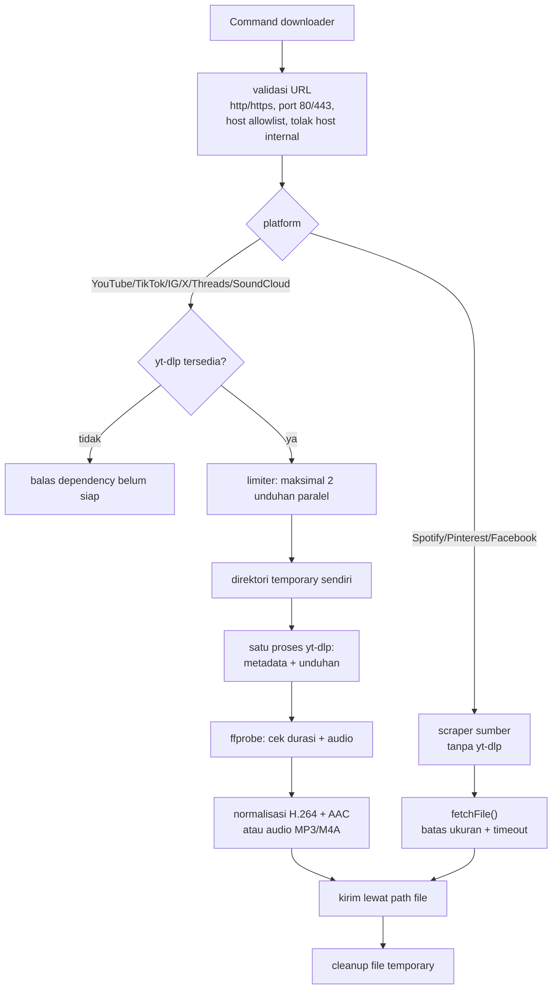

Downloader memakai allowlist platform, batas ukuran (`DOWNLOAD_MAX_MB`), durasi (`DOWNLOAD_MAX_DURATION_SEC`), timeout, dan antrean. Auto-install yt-dlp hanya dari rilis resmi GitHub dengan verifikasi checksum SHA-256 dan nonaktif secara default. File sementara selalu dibersihkan di blok `finally`.

**AI** (`.ai`, `.summary`, `.translate`, `.chatbot`, `.resetai`):

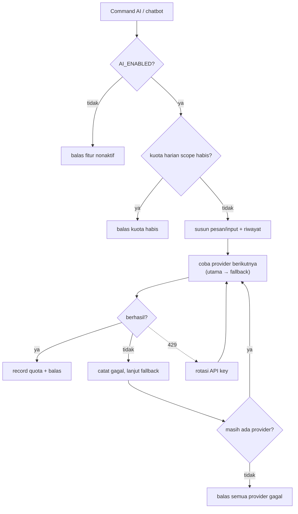

`AiService` memakai key pool, rotasi key saat rate limit, retry ringan, circuit breaker (3 kegagalan → jeda 30 detik), kuota harian per user/chat, dan redaksi API key dari log/error.

**Ekonomi** — setiap pesan valid memberi XP pasif 10–20 dengan cooldown 45 detik. `.daily` memberi 500 koin + 150 XP sekali per 24 jam; level dihitung dari total XP `50 × n × (n − 1)`. `.balance`, `.level`, dan `.leaderboard` membaca data yang sama di tabel `users`.

### 7. Data dan persistensi

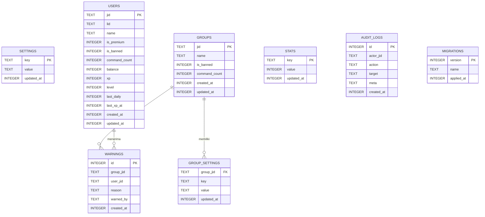

Database memakai `better-sqlite3` dengan prepared statement dan migrasi berurutan (skema awal, ban-control, economy). Nilai kompleks seperti metadata audit disimpan sebagai JSON di kolom `TEXT`.

Backup berjalan otomatis tiap 24 jam dan saat shutdown. `.backup` membuat backup + verifikasi, `.backup verify` mengecek integritas dan jumlah baris, dan `.restore` memulihkan in-place lewat `ATTACH DATABASE` dalam satu transaksi. Restore hanya menerima backup dengan versi skema yang sama, dan membuat backup pengaman sebelum menimpa data.

### 8. Batas dan aturan runtime

| Aturan | Nilai default | Sumber |
|---|---|---|
| Timeout command | 30 detik | `COMMAND_TIMEOUT_MS` |
| Timeout command berat | Diatur per manifest, mis. downloader 660 detik | `timeoutMs` command |
| Cooldown command | 3 detik | `COMMAND_COOLDOWN` |
| Rate limit | 20 command / 60 detik | `RATE_LIMIT_MAX`, `RATE_LIMIT_WINDOW_MS` |
| Queue per chat | 50 pesan menunggu | `QUEUE_MAX_PENDING` |
| Deduplikasi pesan | 1.000 ID terakhir | `core/handler.js` |
| Batas media | 16 MB | `MEDIA_MAX_MB` |
| Batas unduhan | 16 MB / 900 detik | `DOWNLOAD_MAX_MB`, `DOWNLOAD_MAX_DURATION_SEC` |
| Retensi backup | 14 file | `BACKUP_KEEP` |

Mode bot disimpan di database sehingga bertahan setelah restart:

- **public** — semua orang boleh memakai command.
- **private** — owner dan admin grup.
- **self** — owner saja.

Perubahan mode dan maintenance dilakukan lewat command owner dan langsung berlaku tanpa restart. Semua akses database lewat `core/database`, sehingga command tidak menulis SQL sendiri.

Panduan menambah command ada di [docs/DEVELOPMENT.md](docs/DEVELOPMENT.md).

## Dokumentasi

- [Riset & referensi](docs/RESEARCH.md)
- [Daftar fitur & prioritas](docs/FEATURES.md)
- [Roadmap & arsitektur](docs/ROADMAP.md)
- [Keputusan teknis (ADR)](docs/DECISIONS.md)
- [Panduan development](docs/DEVELOPMENT.md)
- [Review Phase 1](docs/REVIEW-PHASE1.md)
- [Review Phase 2](docs/REVIEW-PHASE2.md)

## Referensi Utama

Varr-Bot terinspirasi dari proyek open source berikut:

- [Baileys](https://github.com/WhiskeySockets/Baileys)
- [BotsApp](https://github.com/Prince-Mendiratta/BotsApp)
- [Knightbot-MD](https://github.com/mruniquehacker/Knightbot-MD)
- [neoxr-bot](https://github.com/neoxr/neoxr-bot)
- [Iris](https://github.com/KillovSky/Iris)
- [Atlas-MD](https://github.com/FantoX/Atlas-MD)
- [WhatsAsena / lyfe00011](https://github.com/lyfe00011/whatsapp-bot)
- [games-wabot](https://github.com/BochilGaming/games-wabot)
- [SUBZERO-MD](https://github.com/mrfrankofcc/SUBZERO-MD)
- [STAR-XD](https://github.com/mrxdking/star-xd)

Detail evaluasi, lisensi, dan pelajaran dari masing-masing repo ada di [docs/RESEARCH.md](docs/RESEARCH.md).

## Lisensi & Disclaimer

Varr-Bot memakai lisensi **MIT** — lihat [LICENSE](LICENSE). Kode dari repo MIT boleh dipakai dengan tetap mencantumkan copyright notice. Kode dari repo **GPL-3.0** seperti BotsApp dan games-wabot tidak boleh disalin mentah ke project ini. Referensi yang lisensinya tidak jelas hanya boleh diambil idenya.

Varr-Bot adalah software tidak resmi dan **tidak berafiliasi dengan WhatsApp/Meta**. Penggunaan bot otomatis berisiko membuat nomor dibatasi atau diblokir. Gunakan nomor sekunder, jangan kirim spam, dan patuhi hukum yang berlaku.
